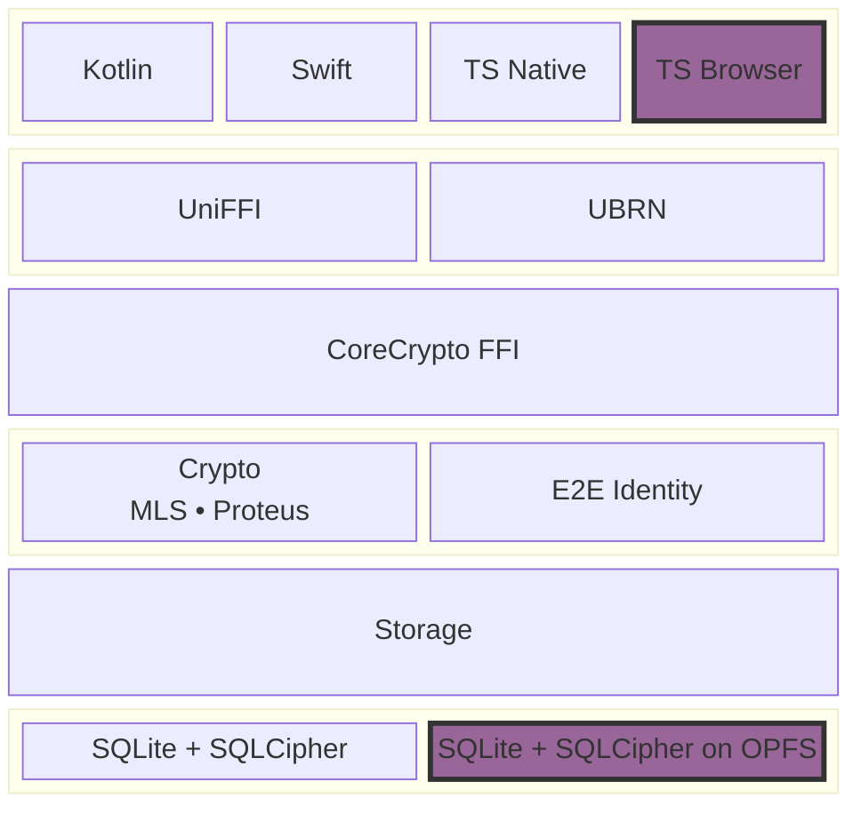
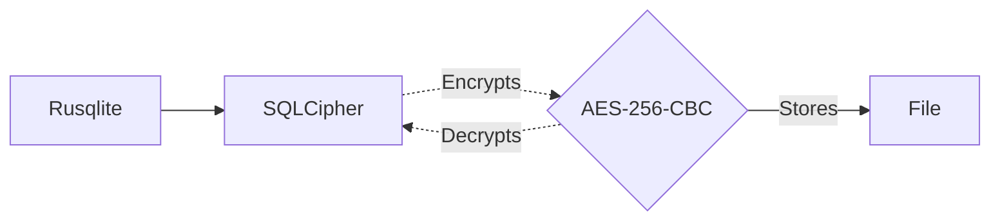

# CoreCrypto Architecture

## CoreCrypto FFI

Allows other programming languages and platforms to embed and interact with `CoreCrypto`

- For iOS and Android, [UniFFI](https://github.com/mozilla/uniffi-rs) is used to produce the relevant Kotlin and Swift
  bindings
- For Typescript we additionally use [UBRN](https://github.com/jhugman/uniffi-bindgen-react-native) to create a WASM
  binary for browser and a native binary for native TS from our UniFFI bindings.

### Data Types

| Rust                    | Swift                              | Kotlin                     | TypeScript                               |
| ----------------------- | ---------------------------------- | -------------------------- | ---------------------------------------- |
| `bool`                  | `Bool`                             | `Boolean`                  | `boolean`                                |
| `u8`                    | `UInt8`                            | `UByte`                    | `number`                                 |
| `u16`                   | `UInt16`                           | `UShort`                   | `number`                                 |
| `u32`                   | `UInt32`                           | `UInt`                     | `number`                                 |
| `u64`                   | `UInt64`                           | `ULong`                    | `bigint`                                 |
| `i8`                    | `Int8`                             | `Byte`                     | `number`                                 |
| `i16`                   | `Int16`                            | `Short`                    | `number`                                 |
| `i32`                   | `Int32`                            | `Int`                      | `number`                                 |
| `i64`                   | `Int64`                            | `Long`                     | `bigint`                                 |
| `f32`                   | `Float`                            | `Float`                    | `number`                                 |
| `f64`                   | `Double`                           | `Double`                   | `number`                                 |
| `String` / `&str`       | `String`                           | `String`                   | `string`                                 |
| `std::time::SystemTime` | `Date`                             | `java.time.Instant`        | `Date`                                   |
| `std::time::Duration`   | `TimeInterval`                     | `java.time.Duration`       | `number` (in milliseconds)               |
| `Option<T>`             | `Optional<T>`                      | `Optional<T>`              | `T?`                                     |
| `Vec<T>`                | `Array<T>`                         | `List<T>`                  | `Array<T>`                               |
| `HashMap<String, T>`    | `Dictionary<String, T>`            | `Map<String, T>`           | `Record<string, T>`                      |
| `()`                    | `nil`                              | `null`                     | `null`                                   |
| `Result<T, E>`          | `func placeholder() throws E -> T` | `T placeholder() throws E` | `function placeholder(): T // @throws E` |

For more information, see [UniFFI Docs](https://mozilla.github.io/uniffi-rs/next/types/builtin_types.html) and
[UBRN Docs](https://jhugman.github.io/uniffi-bindgen-react-native/idioms/common-types.html)

## CoreCrypto

CoreCrypto provides a unified abstraction layer over MLS and Proteus. It exposes a simplified interface built around
application-level entities rather than protocol-specific concepts.

## Database

Encrypted Keystore powered by SQLCipher. It provides a persistent data storage layer with encryption at-rest.

### Native (iOS, Android, Ts-Native)

Pretty much everything is handed off to SQLCipher:

- Backing store: Encrypted SQLite database (with [SQLCipher](https://www.zetetic.net/sqlcipher/))
- Encryption: AES256-CBC with per-page IV (provided by [SQLCipher](https://www.zetetic.net/sqlcipher/)).
  - Value-Level Encryption is also possible on the
    [Commercial or Enterprise editions](https://www.zetetic.net/sqlcipher/value-level-encryption/) if we want additional
    security guarantees
- Crypto primitives provider: [OpenSSL](https://www.openssl.org/)
- PRNG provider: [OpenSSL](https://www.openssl.org/)

See [SQLCipher design](https://www.zetetic.net/sqlcipher/design/)

Summary:

- SQLCipher's file page size by default is 4096 bytes
- When using a passphrase (our case), the provided passphrase is derived using PBKDF2-HMAC-SHA512.   The salt of
  this KDF is stored in the 16 first bytes of the file.
  - Note: This cannot be kept as-is on iOS as iOS needs to be able to read the first 16-32 bytes of SQLite databases to
    "magically" guess they are SQLite databases  and to allow reading them from the background. This is very useful
    in the case of background work on iOS such as encrypted data in notifications needing access to the keystore. 
- Each page is encrypted or decrypted on-the-fly using AES256-CBC
  - Provided by OpenSSL -`v1.1.1p` as of 29/06/22- in our case, but the crypto provider can be changed to NSS,
    LibTomCrypt or Security.framework
- Each page is written with a unique, random IV (*initialization vector*). This IV is regenerated on each page write.
  This IV is appended at the end of each page.
- Page ciphertexts are authenticated using an authentication tag using HMAC-SHA512. This tag is also appended at the
  each of the page.

### WASM

The same as native, except:

- Backing store: a file in OPFS, accessed through a custom VFS
- Crypto primitives provider: [LibTomCrypt](https://github.com/libtom/libtomcrypt)
- PRNG provider: [Crypto.getRandomValues](https://www.w3.org/TR/WebCryptoAPI/#Crypto-method-getRandomValues)
